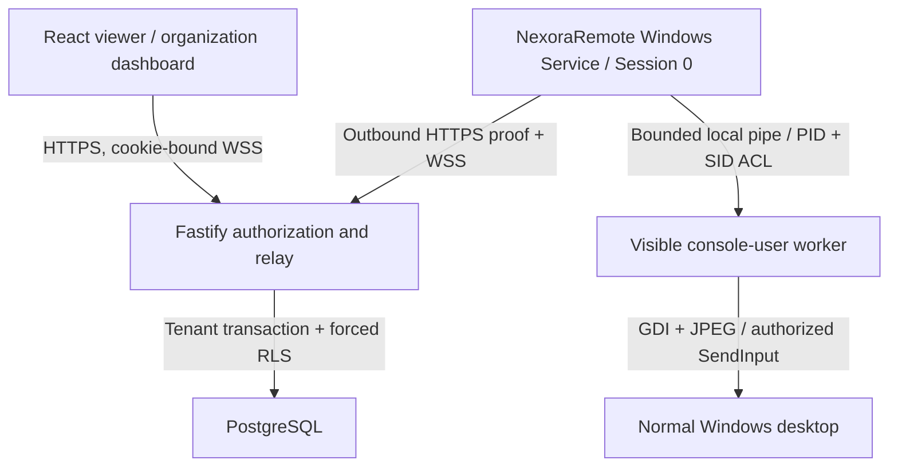

# Phase 2 architecture

## Existing monorepo preserved

React/Vite/TypeScript and Fastify/PostgreSQL remain. Migration 001 is unchanged; 002 adds default-enforced device ACLs and hashed MFA recovery records. Live sockets/tickets/presence are process-local: one backend instance is supported; horizontal relay/presence routing is not implemented.

## Windows roles

One protected binary has explicit entry roles: `--service` runs ServiceBase without invoking interactive Windows capture; `--worker <random-pipe>` runs the visible console-session Form; `--configure-service` opens administrator-approved machine setup. Default per-user mode remains for direct validation/development. Machine startup is a visible automatic Windows service, not a hidden scheduled process.

The service alone loads DPAPI LocalMachine identity under SYSTEM/Admin-only ProgramData ACL and performs outbound RSA proof/reconnect/heartbeat and signed grant verification. It obtains the active console user's primary token through WTSQueryUserToken and launches the fixed Program Files binary on `winsta0\\default` with CreateProcessAsUser. No Windows password, arbitrary command line, secure-desktop bypass or interactive Session 0 access is used. RDP/multi-user selection beyond the active console is not complete.

A random FirstPipeInstance pipe denies Network SID, allows only SYSTEM and target user, verifies the launched worker PID; worker checks the pipe server against SCM's service PID. Messages are length-prefixed JSON capped at 3 MiB with deadlines and serialized RPC. The worker receives public identity + signed grant only, independently checks signature/scope/expiry/mode/sequence, and captures/injects only on the normal desktop. Local opt-out is visible and persisted in that user's profile. Shutdown closes the pipe and releases input; service recovery is explicit SCM policy.

## Session and transport

REST login, organization role and device ACL authorize sessions. One-use browser tickets are login-cookie/Origin-bound and transported as a subprotocol; Agent tickets use Authorization. URL credentials are rejected. Signed grants use standard RSA/SHA-256, expire within five minutes and within the authorizing login. Inputs/frames check current DB grant, role, device trust and ACL. Replaced viewer sockets are checked before/after awaited DB reads. Revocation and reconnect never resurrect an old grant.

Actual capture is still bounded GDI/JPEG with selected-screen geometry and conservative FPS adaptation. No WGC, DXGI, H.264 or WebRTC implementation is claimed. JPEG transport is relayed standard TLS in deployment, not E2E media encryption. Viewer measures decoded FPS/received bitrate/server RTT; separate Windows tests measure action-to-text-observation on loopback.

## Evidence scope

The automated direct-Agent loopback path uses the real server, RSA enrollment, signed grants, GDI/JPEG relay, SendInput, quality scaling and reauthentication. It does not exercise the full service→WTS worker→pipe path after machine enrollment/reboot, nor two physical devices over LAN/TLS. Native pipe/DPAPI checks and SCM install/start/stop/upgrade/uninstall are separate evidence. See phase2/CI_VERIFICATION.json and phase2/TWO_WINDOWS_KIT.md.
